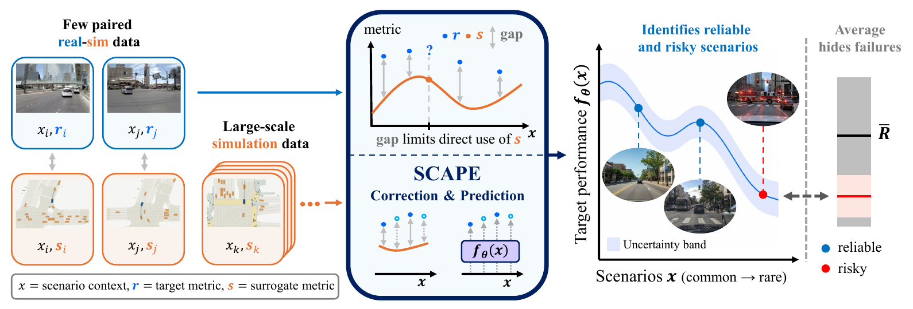

<div align="center">

# SCAPE: Scenario-Conditioned Simulation-Augmented Policy Evaluation

**Official project website for SCAPE** · **CoRL 2026** · [🌐 Project Page](https://ucla-tams-lab.github.io/scape-website/)

**Dijie Zhu**<sup>1</sup> · **Seunghun Oh**<sup>1,2</sup> · **Ruopeng Huang**<sup>1,3</sup> · **Zhiyu Huang**<sup>1,4</sup> · **Jiaqi Ma**<sup>1</sup> · **Chen Tang**<sup>1</sup>

<sup>1</sup>UCLA · <sup>2</sup>Seoul National University · <sup>3</sup>USC · <sup>4</sup>NC State

[](https://arxiv.org/abs/2608.19425)
[](https://ucla-tams-lab.github.io/scape-website/)
[](https://github.com/ucla-tams-lab/scape)

</div>

<p align="center">
  <a href="https://ucla-tams-lab.github.io/scape-website/">
    
  </a>
</p>
<p align="center"><b><a href="https://ucla-tams-lab.github.io/scape-website/">Explore the method and full results on the project page</a></b></p>

This repository hosts the **official project website for SCAPE**. For evaluator training, baselines, and experiment reproduction, see the repositories in the [Repository guide](#repository-guide). The [project page](https://ucla-tams-lab.github.io/scape-website/) contains the paper, method overview, and experimental results.

---

## TL;DR: Evaluate policies beyond their average performance.

Real-world testing is costly, simulation is biased, and average performance can hide scenario-specific failures. **SCAPE predicts real-world policy performance for each scenario** by combining limited paired real–simulation evaluations with abundant simulation-only data.

The method follows **correction before augmentation**: learn a scenario-dependent correction, use corrected simulation labels to train an evaluator, and calibrate its uncertainty with held-out target data. At inference, the evaluator needs only the scenario context.

## Repository guide

This repository is organized into **two branches**:

| Branch | Purpose |
| --- | --- |
| **`main` (here)** | **Project overview.** README, presentation assets, and links to the implementation. |
| [**`gh-pages`**](https://github.com/ucla-tams-lab/scape-website/tree/gh-pages) | **Project website.** Published site source and website assets, served by GitHub Pages. |

The experiment code is maintained in the following repositories:

| Repository | Purpose |
| --- | --- |
| [**`scape`**](https://github.com/ucla-tams-lab/scape) | **Evaluation pipeline.** SCAPE training, neural and statistical baselines, and prediction, conformal, OOD, and planner-selection evaluation. |
| [**`scape-locomotion`**](https://github.com/ucla-tams-lab/scape-locomotion) | **Locomotion experiments.** Go2 data generation for Sim2Sim and Sim2Real evaluation. |

---

<details>
<summary><b>Website maintenance and local preview</b></summary>

This is a static website served by GitHub Pages from the root of the [`gh-pages` branch](https://github.com/ucla-tams-lab/scape-website/tree/gh-pages).

- [`index.html`](https://github.com/ucla-tams-lab/scape-website/blob/gh-pages/index.html): page content, paper links, and BibTeX.
- [website images](https://github.com/ucla-tams-lab/scape-website/tree/gh-pages/static/images): teaser, method, and result figures.
- [stylesheet](https://github.com/ucla-tams-lab/scape-website/blob/gh-pages/static/css/style.css): page styling.

Preview locally:

```bash
git clone --branch gh-pages --single-branch https://github.com/ucla-tams-lab/scape-website.git
cd scape-website
python3 -m http.server 8000
```

Open [http://localhost:8000](http://localhost:8000) in your browser.

</details>

---

## Citation

```bibtex
@inproceedings{zhu2026scape,
  title     = {{SCAPE}: Scenario-Conditioned Simulation-Augmented Policy Evaluation},
  author    = {Zhu, Dijie and Oh, Seunghun and Huang, Ruopeng and Huang, Zhiyu and Ma, Jiaqi and Tang, Chen},
  booktitle = {Conference on Robot Learning (CoRL)},
  year      = {2026}
}
```

## Acknowledgments

Website layout inspired by [Nerfies](https://nerfies.github.io).
